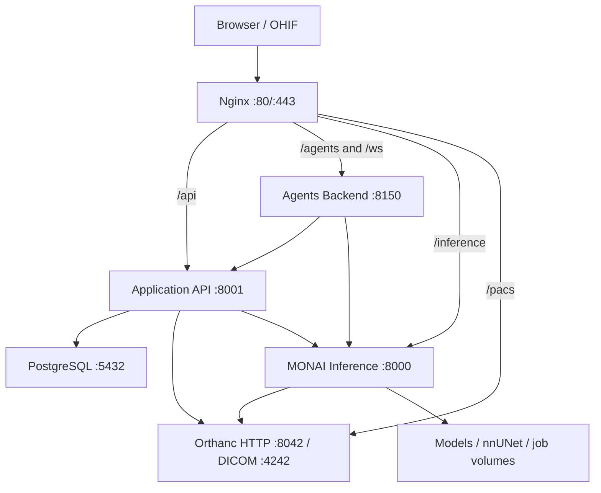

# System Architecture

The production architecture uses one public origin and separates PostgreSQL work from GPU inference. The decision and benchmark evidence are documented in [load-test-decision.md](./load-test-decision.md).

## Service ownership and ports

| Service | Internal port | Production ingress | Responsibility |
|---|---:|---|---|
| OHIF + Nginx | `80/443` | Public | UI and same-origin routing |
| Application API | `8001` | `/api/*` | PostgreSQL CRUD, chat, workflow metadata, Orthanc sync |
| Agents Backend | `8150` | `/agents/*`, `/ws` | Agent planning/execution, MCP, population workflows, events |
| MONAI Inference | `8000` | `/inference/*` | Model loading, inference, dataset preparation and training jobs |
| Orthanc | `8042`, DICOM `4242` | `/pacs/*` | PACS and DICOMweb |
| PostgreSQL | `5432` | None | Single system of record |

Development publishes `8001`, `8150`, `8000`, host `8043→8042`, and host `5433→5432`. Production uses `docker-compose.backend.prod.yml`, which removes every published backend port; only Nginx publishes `80/443`.

## Important boundaries

- Only the Application API receives `DATABASE_URL` and registers database routers.
- All PostgreSQL source ownership lives under `Backend/application_api/`, including ORM models, repositories, schemas, seeders, and Alembic migrations.
- MONAI does not run Alembic or seed the database. One-shot `db-migrate` and `db-seed` services run before the Application API.
- Inference and training jobs share a bounded queue. Default concurrency is one running job plus eight queued jobs.
- Application health depends on PostgreSQL, not MONAI or Orthanc. Inference or PACS failures affect only the operations that require them.
- PostgreSQL remains the only application datastore; MongoDB is not part of this architecture.

## Request flow

1. Browser CRUD and chat calls use `/api` and reach port `8001`.
2. Browser model operations use `/inference` and reach port `8000`.
3. Agents persist state through `APP_API_URL` and submit inference through `INFERENCE_API_URL`.
4. Orthanc sends stable-series webhooks to the Application API.
5. Workflow training starts on `8001`, returns a job ID, and executes dataset preparation on `8000` without giving MONAI database access.

## Verification

- Contract tests enforce router ownership and bounded chat-session responses.
- Integration tests cover service health and the same-origin HTTP routes.
- Load and contention tests live in `Backend/tests/load`.
