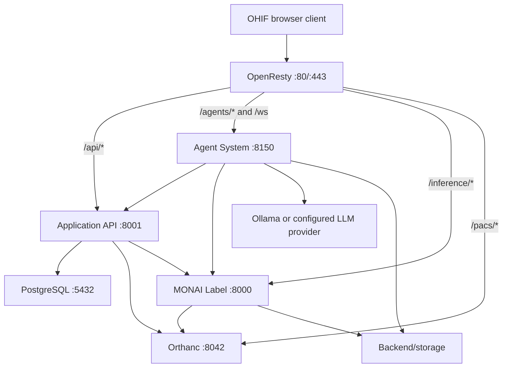

# CUBE.AI system overview

This page maps the current product and codebase. For subsystem details, follow the links from the [documentation hub](./README.md).

## Purpose

CUBE.AI brings medical-imaging research into one browser experience: DICOM viewing, annotation workflows, assisted segmentation, cohort selection, radiomics feature extraction, machine-learning modeling, and generated reports.

The platform separates four kinds of state:

1. Orthanc stores DICOM instances and exposes DICOMweb.
2. PostgreSQL stores application metadata and research records.
3. `Backend/storage/` stores generated images, masks, models, features, jobs, and reports.
4. The agent process holds bounded, session-scoped runtime state while a pipeline is active.

## Components and ownership

| Component | Source | Responsibility | Development port |
|---|---|---|---:|
| OHIF Viewer | `Frontend/OHIF-Viewer/` | Worklist, viewer, workflows, assisted segmentation, Research Playground | `3000` |
| OpenResty | viewer recipe Nginx config | Production static hosting and same-origin reverse proxy | `80`, `443` |
| Application API | `Backend/application_api/` | PostgreSQL CRUD, chats/plans, workflow metadata, Orthanc synchronization | `8001` |
| Agent System | `Backend/agent_system/` | LLM planning, pipeline execution, WebSocket sessions, reviews, reports | `8150` |
| Agent MCP tools | `Backend/mcp/` | Population, radiomics, modeling, scratchpad, and report tools | internal |
| MONAI Label | `Backend/monailabel/`, `Backend/apps/radiology/` | Inference, data preparation, training jobs, dynamic models | `8000` |
| Orthanc | `Backend/orthanc/` plus container image | PACS, DICOMweb, stable-series notification | `8043 -> 8042` |
| PostgreSQL | container image | Structured system of record | `5433 -> 5432` |

## Architecture



OpenResty removes the external prefixes before forwarding requests. FastAPI routes therefore do not include `/api` or `/agents` in their definitions. `/ws` is proxied separately with a WebSocket upgrade. Internal agent event-ingress routes are blocked at public ingress.

## Repository map

```text
OHIF-Standalone/
|-- AGENTS.md                         Codex discovery and repository rules
|-- .codex/                           concise project context for Codex
|-- Backend/
|   |-- application_api/              database-owning FastAPI service
|   |-- agent_system/                 multi-agent orchestrator
|   |-- mcp/                          tools callable by execution agents
|   |-- monailabel/                   MONAI server startup/custom routes
|   |-- apps/radiology/               inference, trainers, models, transforms
|   |-- orthanc/                      Orthanc JSON and Lua hooks
|   |-- storage/                      generated runtime data boundary
|   |-- storage_paths.py              canonical storage resolver
|   `-- tests/                        unit through deployed/load tests
|-- Frontend/OHIF-Viewer/
|   |-- platform/app/                 viewer shell, worklist, shared routes
|   |-- extensions/research-playground/
|   |-- extensions/monai-label/
|   `-- modes/monai-label/
|-- deploy/                           Dockerfiles, Compose files, env template
|-- scripts/                          Windows and Unix launchers
`-- cubeai-docs/                      project documentation
```

## Runtime workflows

### DICOM ingestion

1. A study is uploaded or sent to Orthanc.
2. Orthanc's Lua script detects a stable series and calls `POST /sync/orthanc-webhook` on the Application API.
3. The Application API reads DICOM metadata from Orthanc and upserts patient, study, and volume-series records in PostgreSQL.
4. OHIF gets pixels and DICOM metadata through DICOMweb and workflow metadata through the Application API.

### Research pipeline

1. The frontend creates or opens a chat session and connects to `/ws` with a `session_id`.
2. Planning turns the user's clinical question into a structured hypothesis and execution plan; an optional literature review adds evidence context.
3. The user reviews the plan. Population selection and segmentation may also pause for explicit review.
4. The execution graph selects registered agents for population, segmentation, feature extraction, modeling, result reporting, and LaTeX reporting.
5. Agents use MCP tools, persist records through the Application API, submit compute to MONAI, and write artifacts to their session workspace.
6. Node state, logs, resource waits, user-input requests, and completion events stream back over the WebSocket.

Every connection, message, event, plan, execution monitor, and replay operation is scoped to a session. The backend bounds connections and queues; the frontend rejects cross-session traffic, deduplicates event identifiers, and uses bounded reconnect buffers.

### Segmentation and training

MONAI Label owns model discovery and execution. Agent-driven segmentation can choose automatic or interactive review paths. Workflow training begins at the Application API so database-backed workflow state remains there, then delegates the long-running job to MONAI and returns a job ID for polling.

Inference/training jobs and agent-side GPU/CPU-heavy tasks use separate bounded schedulers. `WAITING_FOR_RESOURCE` means computation is queued; it is not a request for user input.

## Data and generated files

The Application API exclusively owns SQLAlchemy models, repositories, schemas, seeders, and Alembic migrations. Compose runs `db-migrate`, then `db-seed`, before starting it. `/health/ready` verifies database connectivity and the current Alembic revision.

Generated files use the structure documented in [`Backend/storage/README.md`](../Backend/storage/README.md):

- Use `Backend/storage_paths.py`; do not assemble workspace paths ad hoc.
- Durable session data lives under `hypotheses/workspace_<session-id>/{state,data,outputs}`.
- Global datasets, nnUNet data, weights, dynamic model state, and job records are durable.
- Cache and temporary directories are disposable, but images, masks, features, models, reports, and migration backups are not caches.
- Everything under `Backend/storage/` except its README is ignored by Git.

## Configuration and deployment

Copy `deploy/.env.example` to `deploy/.env`. Real values may contain credentials and must not be logged or committed.

Choose one backend base:

- `deploy/docker-compose.backend.cpu.yml`
- `deploy/docker-compose.backend.gpu.yml`

Optional overlays are `docker-compose.backend.dev.yml` for development, `docker-compose.backend.prod.yml` to remove published backend ports, and `docker-compose.frontend.prod.yml` for production OHIF/OpenResty.

The launcher scripts are the normal entry point because they set paths, check Docker/Ollama, migrate legacy storage safely, select CPU/GPU, wait for health, and show logs.

## Verification

```powershell
# Backend unit, contract, and pipeline tests
powershell -ExecutionPolicy Bypass -File Backend/tests/run_tests.ps1 -Suite deterministic

# Generated-data boundary
powershell -ExecutionPolicy Bypass -File Backend/scripts/check_storage_boundary.ps1

# Read-only deployed smoke test; requires running services and Docker
powershell -ExecutionPolicy Bypass -File Backend/tests/load/run.ps1 -Profile smoke
```

```bash
cd Frontend/OHIF-Viewer
yarn test:unit:ci
yarn build
```

Do not run load, GPU, radiology, live-LLM, or end-to-end suites without their documented dependencies.

## Change routing

| Change | Start here | Also verify |
|---|---|---|
| CRUD/schema | `Backend/application_api/` | migration, schema, API docs, frontend caller |
| DICOM synchronization | Application API `sync.py`, Orthanc Lua | stable-series behavior and integration tests |
| Inference/model | `Backend/apps/radiology/` | MONAI routes, CPU/GPU images, job limits, storage |
| Agent/pipeline stage | planning agents, `execution_team.py`, MCP | I/O contract, session isolation, resource state |
| Research canvas/events | research-playground extension | WebSocket protocol, replay/reconnect, Jest/build |
| Public route/service | OpenResty and Compose | direct dev URL, production prefix, health check |
| Runtime path | `Backend/storage_paths.py` | migration compatibility and boundary test |

## Further reading

- [Architecture and ingress](./architecture/README.md)
- [Backend](./backend/README.md)
- [Agent system](./agent-system/README.md)
- [API reference](./api-reference/README.md)
- [Database](./database/README.md)
- [Research Playground](./research-playground/README.md)
